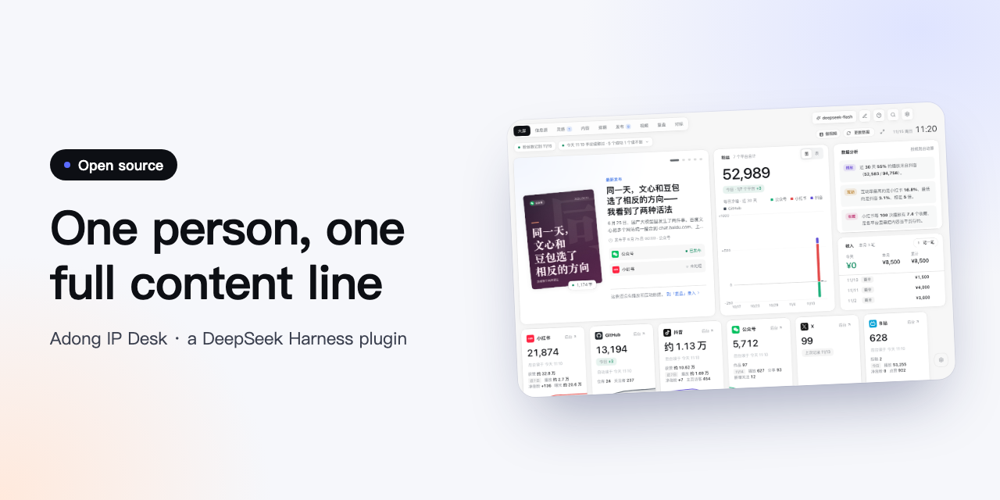
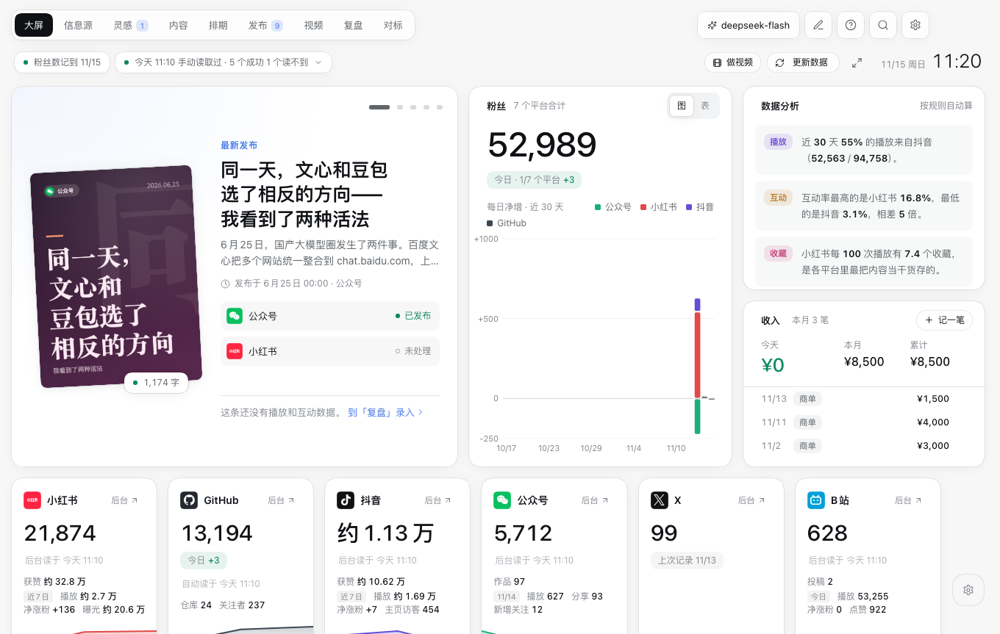
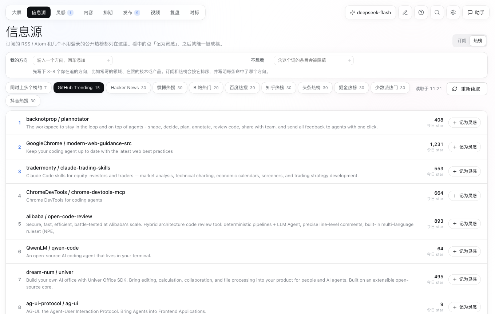
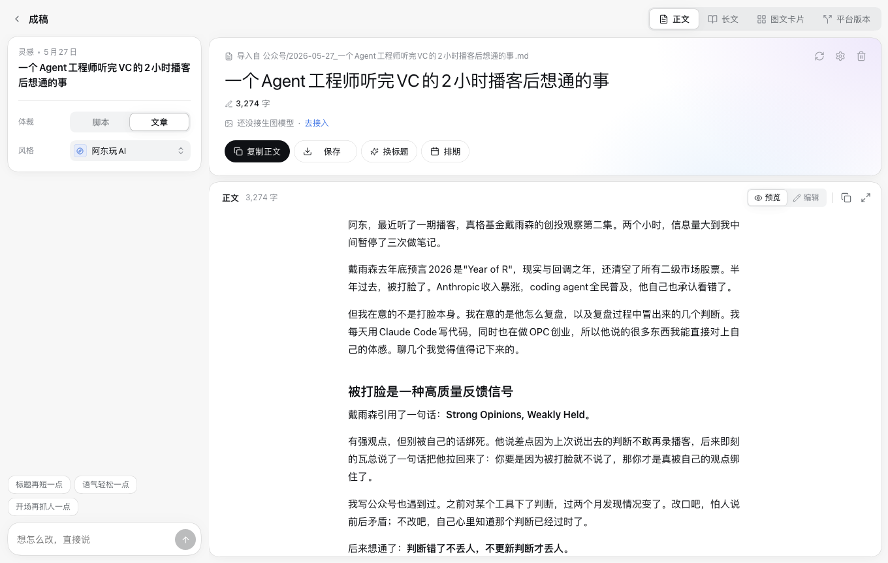
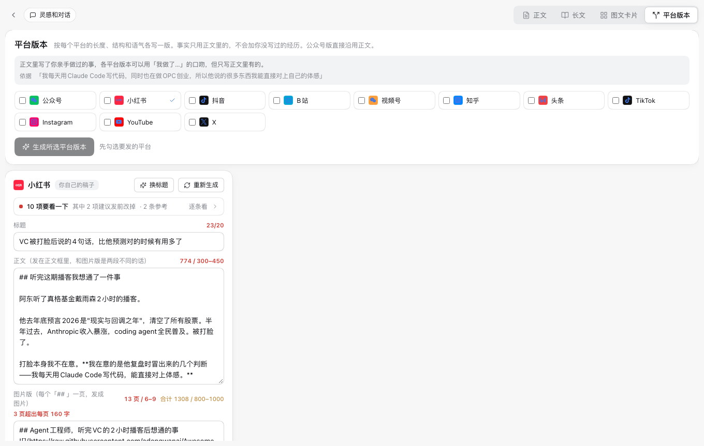
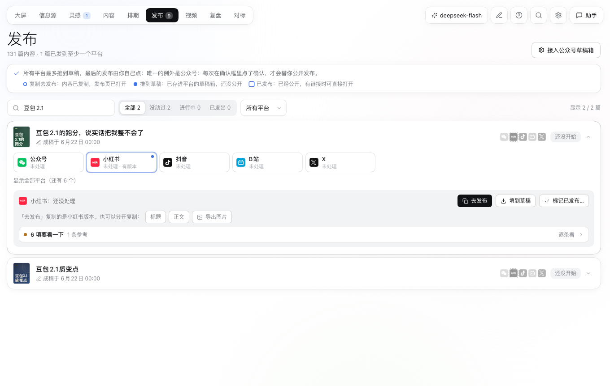
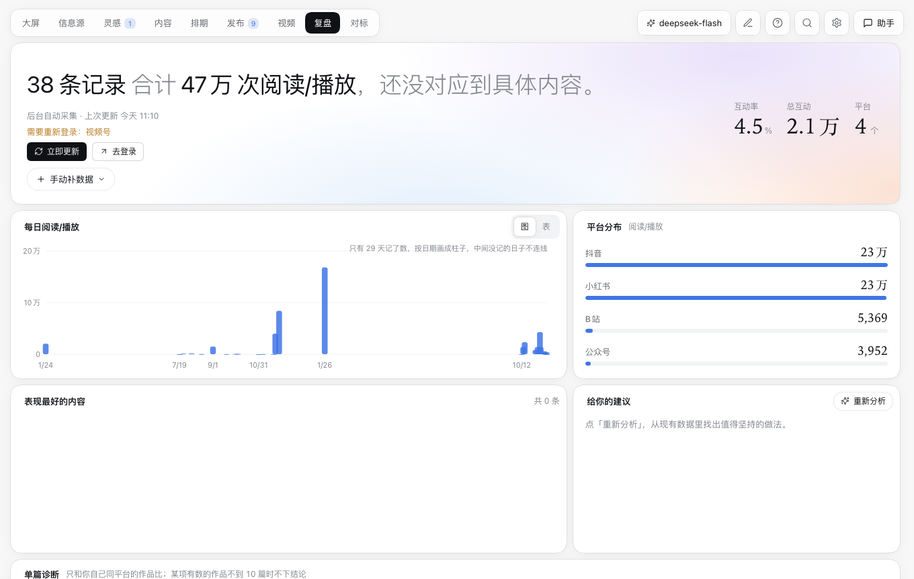

<p align="center"></p>

<h1 align="center">Adong IP Desk · Community Edition</h1>

<p align="center">From an idea to articles, image cards, spoken scripts and video — a local-first workspace powered by DeepSeek Harness.</p>

<p align="center">
  <a href="#install">Install</a> ·
  <a href="#what-you-need-to-set-up">Setup</a> ·
  <a href="#what-it-does-not-do">What it doesn't do</a> ·
  <a href="#known-limitations-and-unverified-parts">Known limitations</a> ·
  <a href="README.md">简体中文</a>
</p>

Adong IP Desk is a plugin for [DeepSeek Harness](https://github.com/deepseek-ai/deepseek-harness) (DSH). It opens as a full-page desk in the sidebar. It is a fork of [dsh-media-desk](https://github.com/woniuniuniu/dsh-media-desk) (MIT) by [蜗牛的科技笔记](https://www.xiaohongshu.com/user/profile/5faedce8000000000101c8a3), extended by 阿东玩AI on top of upstream 2.7.0. All data stays on your machine, text generation uses the model you configured in DSH, and publishing stops at drafts (WeChat Official Accounts can publish after you confirm each time). You always press the final publish button yourself.

```
Sources → Ideas → Draft → Layout → Platform versions → Publish (to drafts) → Data → Benchmarks     plus: Video
```

Pages: Dashboard · Sources · Ideas · Content · Schedule · Publish · Video · Insights · Benchmarks, with Writing style in the top-right corner. The interface is in Chinese and English. The Chinese README is the more detailed and authoritative one; this is a shorter summary.

The first time you open the desk, a **How to use** panel appears. It offers five paths (a sponsored post, a trending topic, moving old drafts in, a morning check, a talking-head video). Each step is one sentence with a **Take me there** button. Reopen it any time from the `?` icon at the top right or from the command palette.

<br>

**Community edition 0.1.0** · [Source code](https://github.com/adongwanai/adong-media-desk) · [Download](https://github.com/adongwanai/adong-media-desk/releases/tag/v0.1.0) · [简体中文](README.md)

Install it on your own computer, connect your DSH model, and bring your own accounts, writing style and reference materials. Start with one topic, draft through a continuous Agent conversation, then adapt the result into articles, image cards or a spoken script for the video workspace. New installations have no author accounts, posts, signatures or credentials.

## Screenshots

| | |
| --- | --- |
|  |  |
|  |  |
|  |  |

Screenshots retain the author’s original account data to show real usage. Fresh installations start empty; the accounts and content pictured are not imported, and no credentials or personal style are bundled.

<br>

## Features

- **Dashboard**: total followers with today / 7-day / 30-day change, daily net gain for 30 days, the latest posts, a few rule-based observations (no model call), and one card per platform. Cards show where each number came from and when it was read, up to four account stats, a 30-day trend and the latest post.
  - **How the follower total is computed**: the latest recorded follower count of each platform, summed. **GitHub stars are included. Google Scholar citations are not** (the Scholar card still shows them). When some platforms have no number, the total says how many platforms it covers.
  - **Income tile**: today, this month, total and recent entries. You log each payment yourself (amount, date, source, which post it came from, note). Nothing is connected to a payment service and nothing is estimated.
- **Sources**: any RSS / Atom feed, a 14-feed starter catalog, four built-in public sources (two follow-builders feeds, HF Daily Papers, a Chinese AI news digest), and 10 login-free trending lists (GitHub Trending, Hacker News, Weibo, Bilibili, Baidu, Zhihu, Toutiao, Juejin, SSPAI, Douyin). Optional topic words re-rank items. Cached results appear first; automatic checks run once per Beijing calendar day, and new subscriptions fetch independently. You can also refresh manually.
- **Ideas**: quick capture (`⌘⇧I` / `Ctrl+Shift+I`) anywhere in DSH, search and tags, a topic score card, a daily review of old ideas, and read-only import of a Markdown / Obsidian folder.
- **Draft**: native DSH Agent sessions with streamed text, reasoning/tool activity and a live document preview. The same draft retains its conversation context. References and installed skills are loaded on demand. Start with a single topic; audience, core judgment and writing mode are optional. Switch between body text, long-form layout, image cards and a separate spoken script, then import that script into Video. Upstream's titles, covers, images and storyboards are still there. 16 generic style presets, plus styles extracted from your own posts or links.
- **Revisions**: edit a selected passage, request a focused change in chat, or restore a saved draft snapshot. Chat edits can use native file tools and update the preview directly. Selection-only rewrites use DSH's lightweight model service with nearby text and style hints; they do not load the full Agent context or Skills. Use chat for research, tool use and continuing conversations.
- **Layout**: 言起 YANQI themes for long articles and image cards (30 themes, 12 card skeletons, 14 fonts, 16 cover styles), side-by-side editor and preview, PNG / ZIP export. Choose a title-only cover or compact flow, resize images from edges and corners, highlight key text and turn article links into footnotes. Card identity starts blank; fill in your own details or import your own YANQI `note-to-red` settings from a configured Obsidian vault.
- **Platform versions**: one version each for RedNote (body plus a separate image-card version), Douyin, Bilibili, WeChat Channels, Zhihu, Toutiao, X, YouTube, TikTok and Instagram, with a local self-check and one targeted revision for failing items.
- **Publish**:
  - **Copy & open** copies a platform's version and opens its publish page.
  - A pre-publish check runs locally (contact info, external links, absolute claims, placeholders, AI-tone rules).
  - WeChat Official Account drafts go through the official API, and publishing needs your confirmation every time.
  - Zhihu and Bilibili articles can be synced as drafts through your own Wechatsync extension.
  - **Fill as draft (RedNote image posts only)**: the dedicated browser opens the RedNote publish page, uploads the image-card PNGs, fills in the title, body and topics, clicks 暂存离开 ("save and leave") and stops. It only ever clicks three buttons, and publish-type buttons are blocked. It stops at login pages, captchas or unknown hosts. No other platform has this.
- **Data**: three sources, described below.
  - Per-post diagnosis compares a post only with your own posts on the same platform and draws no conclusion with fewer than 10 data points.
  - Untracked numbers are shown as "—", never as 0.
- **Benchmarks**: track other creators' follower counts with the same public readers (Bilibili, X via FxTwitter, GitHub stars, Google Scholar citations; YouTube subscriber counts are not recorded). Pasted post data is tiered against the creator's own median.
- **Video**: script → record (teleprompter, camera or screen, or upload a file) → rough cut by silence detection → captions → 6 templates rendered in the browser → publish pack. Export to MP4 needs ffmpeg. There is no built-in voice-over.
- **Command palette and shortcuts**: `⌘K` inside the desk and `⌘⇧K` anywhere in DSH. Press `?` for the full table.

### Data collection

| Method | How | What you get |
| --- | --- | --- |
| Profile links | Paste profile URLs on the Dashboard | Public endpoints only: GitHub (stars, repos), Bilibili (followers, likes, uploads), X (via the third-party FxTwitter API), Google Scholar (citations, h-index), YouTube (latest video) |
| Signed-in creator dashboards | Turn on **Signed-in creator dashboards** in settings, click **Open the dedicated browser to sign in**, and sign in yourself once | Followers, likes, recent views and engagement from the RedNote, Douyin, WeChat Official Account, WeChat Channels and Bilibili creator dashboards, plus per-post numbers from their content lists (except WeChat Channels) |
| Manual | **Add data manually** on Insights: type numbers or paste a table | Everything else |

- **Read-only**: the dedicated browser opens allow-listed dashboard pages in new tabs and takes only the page text. It never clicks, types, submits or touches cookies, and it closes its own tabs afterwards.
- **How numbers are recognised**: the DSH model quotes each number's original text. The code then checks that the quote really appears on the page and converts it. A follower count that differs from the previous record by more than half is held as "to confirm" rather than saved.
- **Schedule**: two runs a day, by default **06:30 and 18:30**. The first run reads everything; the second reads only the signed-in dashboards. Both times can be changed and the second can be turned off. Missed runs catch up when DSH opens.
- **Refresh and limits**: public data also refreshes when the Dashboard opens and is more than 6 hours old. Manual reads of the same dashboard are at least 10 minutes apart. Platforms that failed in a run are retried once after 20 minutes and once more 40 minutes later. Platforms that need a new login, or whose follower count is waiting for confirmation, are not retried. When a dashboard redirects to a login page or comes back empty, a screenshot is kept in the local `files/` folder (at most 3 per platform).
- **Your account, your risk**: it uses your own login, so frequent reads may trigger platform risk controls.

**Removed third-party data integrations.** Two data features that relied on outside services are gone:

- upstream's account import through the paid third-party service Monid;
- this fork's earlier "read data" feature (backfilling post stats from public links, and WeChat official statistics).

The three sources above are now the only ones.

<br>

## What you need to set up

The plugin ships with no keys. Anything you don't configure is simply unavailable.

| Feature | Needs |
| --- | --- |
| Drafting, rewriting, platform versions, titles, dashboard number recognition | A text model configured in DSH |
| Covers, images, storyboards | An image API (OpenAI-compatible, Alibaba Bailian, Wanxiang) or a DSH image tool |
| WeChat drafts / publish / image hosting | AppID and AppSecret, plus your outgoing IP on the WeChat IP allowlist. Publishing needs a verified account |
| Signed-in dashboards, Fill as draft | Chrome, Edge or Chromium on this computer, and your own login in the dedicated browser |
| Zhihu / Bilibili draft sync | The Wechatsync browser extension with its MCP token |
| Video export to MP4 | ffmpeg (lossless export also needs ffprobe) |
| Overseas feeds, HF papers, X profile data | Network access to those sites (a proxy in mainland China) |

Plugin credentials are stored in the local `settings.json` (file mode 600), excluded from browser responses and model prompts, and sent only to their configured services when needed. Native chats use DSH sessions and tools; dashboard number extraction and selection-only rewrites use DSH’s lightweight model service, with a native-task fallback.

<br>

## What it does not do

- No unattended posting. Everything stops at drafts, except WeChat publishing, which you confirm each time. **Fill as draft** never clicks publish.
- No auto-replies to comments or messages.
- No estimated data. Income is only what you log. Fresh community installations start empty; README screenshots show the author’s personal edition.
- No logging in on your behalf.
- No inventing experiences. Unsupported first-person claims are flagged, but you still need to review them.

<br>

## Known limitations and unverified parts

**Not verified end to end in a real environment**

- WeChat drafts, publishing and image hosting were tested only against mocked requests.
- Wechatsync sync was tested against the extension's protocol, not a real installed extension.
- **Fill as draft (RedNote)**:
  - Element selectors are based on the RedNote publish page as observed in November 2026.
  - Automated tests use simulated pages.
  - The full flow was not re-run on a real account while this README was written.
- **Signed-in dashboards**:
  - Read only on macOS with the author's accounts.
  - Browser paths for Windows and Linux are written but untested.
  - Test fixtures come from November 2026 page text, and there is no fixture for the Bilibili dashboard home page.
- **Desktop-only behaviour** was not tested in the DSH desktop app: the built-in side browser, global shortcuts, camera and screen recording. Testing was mostly done in web mode (`dsh --profile web`), on macOS only.
- **English interface**: translations are complete, but the newer features have not been walked through in English.

**Known issues**

- The model sometimes reads the wrong one of two adjacent numbers on a dashboard page. Followers are guarded by the "more than half" rule; other stats are not.
- Smaller models may still produce unsupported first-person sentences. The self-check flags them.
- RedNote length budgets are often exceeded by dense technical posts.
- Below about 1300px width, the assistant panel covers buttons on the right.

The full list is in the [Chinese README](README.md#已知限制与未验证).

<br>

## Install

Requirements: Node.js 24+, npm and official DSH. The community edition is currently checked on macOS with DSH 0.2.2-rc.1.

This edition is not on npm or the plugin market (`dsh-media-desk` on npm installs upstream). Clone the repository (or grab an archive from [Releases](https://github.com/adongwanai/adong-media-desk/releases)) and run:

```bash
git clone https://github.com/adongwanai/adong-media-desk.git
cd adong-media-desk
npm ci
npm run dsh
```

The launcher builds and installs `dsh-ip-workbench` into its own DSH home, `~/.dsh-ip-workbench`, then opens port 4372. Sign in with your own DSH model account and open **Adong IP Desk** from the sidebar. Set `DSH_BIN` if the CLI is not in PATH; change the port with `npm run dsh -- 4382`.

`npm start` opens a standalone UI preview without native AI. Stop it before running DSH on the same port. No personal author style, private documents, credentials or account sessions are included. Configure your own style and reference paths in Settings. The default writing workspace indexes `CLAUDE.md`, `style.md`, `voice/`, `examples/` and `methods/`; native DSH handles installed-skill discovery and selective reading. Private author Skills and third-party paid materials are not bundled.

Data lives in `~/.dsh-ip-workbench/ip-workbench/`. Use `IP_WORKBENCH_HOME` to change the isolated DSH home, and `IP_WORKBENCH_WORKSPACE` to explicitly select your writing workspace. Templates never overwrite existing files. If installing manually into another profile, data uses `$DSH_HOME/ip-workbench`; do not enable this edition and upstream Media Desk in the same profile because they share panel/API IDs.

Uninstalling does not delete data. See [acceptance evidence](docs/ACCEPTANCE.md) and [release notes](RELEASE.md). The package is `private: true` to prevent accidental npm publication, while MIT source distribution and local installation remain available.

<br>

## Credits and license

- **Upstream**: [dsh-media-desk](https://github.com/woniuniuniu/dsh-media-desk) by [蜗牛的科技笔记](https://www.xiaohongshu.com/user/profile/5faedce8000000000101c8a3), MIT. The idea wall, drafting pipeline, schedule, insights, styles and image generation come from upstream. [Contributors](https://github.com/woniuniuniu/dsh-media-desk/graphs/contributors).
- **Plugin system**: [DeepSeek Harness](https://github.com/deepseek-ai/deepseek-harness).
- **Included or ported work** (details in [NOTICE](NOTICE)):
  - [言起 YANQI](https://github.com/adongwanai/yanqi-obsidian) by 阿东玩AI. The parts in this repo are MIT by the author's grant. It is derived from [Note to RED](https://github.com/Yeban8090/note-to-red) by Yeban8090 (MIT). Keep attribution to both.
  - Writing-tone rules from [shuorenhua](https://github.com/MrGeDiao/shuorenhua) and [Humanizer-zh](https://github.com/op7418/Humanizer-zh) (MIT).
  - Silence logic from [auto-editor](https://github.com/WyattBlue/auto-editor) (Unlicense).
  - [Lucide](https://lucide.dev) icons (ISC) and [simple-icons](https://github.com/simple-icons/simple-icons) logos (CC0).
  - Hot-list endpoints referenced from [newsnow](https://github.com/newsnext/newsnow) (MIT).
  - Public feeds from [follow-builders](https://github.com/zarazhangrui/follow-builders) (MIT per its README).
  - React (MIT) in the standalone bundle.
- **Ideas only, no code used**: capwise, ScriptCut, LosslessCut, [Wechatsync](https://github.com/wechatsync/Wechatsync) (the desk talks to your installed extension over its public local protocol), and baoyu-post-to-wechat.
- **Trademarks**: platform logos belong to their owners and are used only to identify platforms. This is a community plugin, not affiliated with DeepSeek or any content platform.
- **License**: [MIT](LICENSE).

**Development**: `npm test`, `npm run build`, `npm run watch`, `npm start`. Never include keys, cookies or session tokens in issue reports. Report bugs via [GitHub Issues](https://github.com/adongwanai/adong-media-desk/issues), including Node / DSH versions, reproduction steps and redacted logs. Arrange a private channel with the maintainer before sharing vulnerability details.
